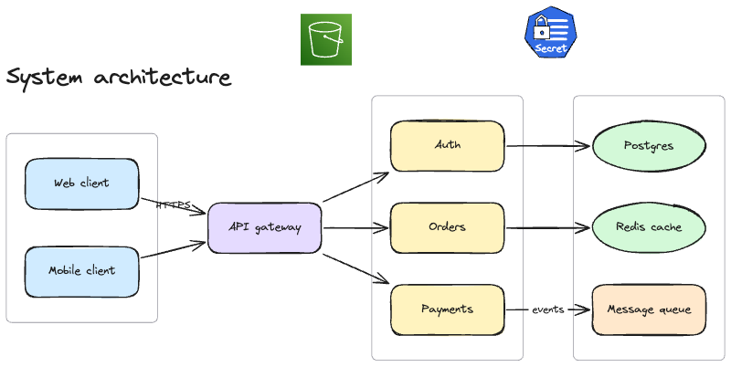
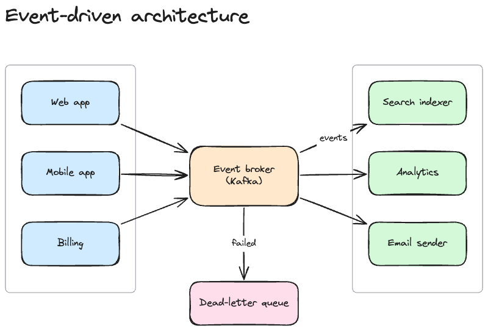
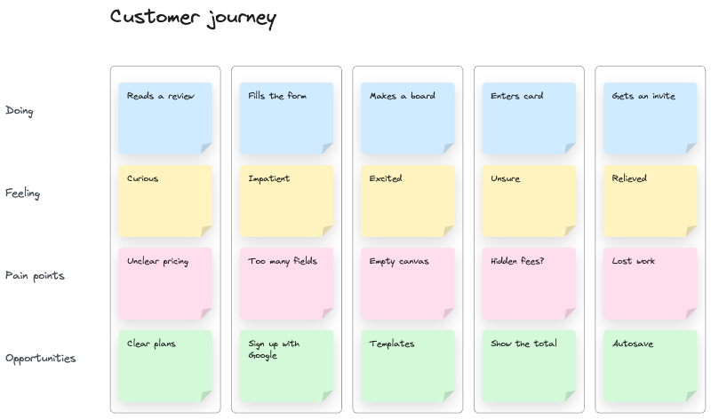

# System Design

The boards of the **System Design** workspace on DWeaver, kept up to date by DWeaver.

Each board is a `.dweaver` file (Excalidraw's element format, images included): open it in DWeaver with
**Import**, or in any tool that reads `.excalidraw` files. Changes go one way, from DWeaver to this repository,
so edit the boards in DWeaver: anything changed in `boards/` or this README is replaced on the next sync.

## Design Uber

[`design-uber-972c8989.dweaver`](boards/design-uber-972c8989.dweaver) · last changed 6 Nov 2026

## Arch Diagram

[`arch-diagram-07af5203.dweaver`](boards/arch-diagram-07af5203.dweaver) · last changed 6 Nov 2026

## Testing one

[`testing-one-9fcb2e68.dweaver`](boards/testing-one-9fcb2e68.dweaver) · last changed 10 Nov 2026

